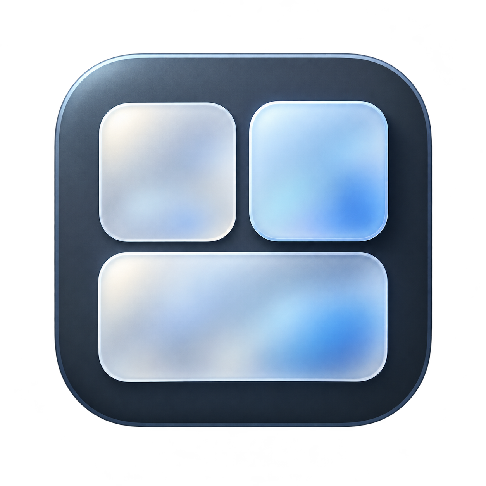

<p align="center"></p>

# ClearDesk

轻量 Windows 桌面整理工具，使用 C#、WPF 和 .NET Framework 4.8 构建。当前版本 **1.5.2**，维护者 [visual-life](https://github.com/visual-life)。

## 功能

- 桌面收纳：文件引用、搜索、网格／列表、拖动排序、调整大小和平滑滚动，不移动原文件。
- 两种材质：实时透明玻璃，以及与桌面位置对齐的静态壁纸磨砂；文字和图标保持清晰。
- 动态 Dock：固定项目、临时运行应用、分割线、运行小点；点击切换或还原已有窗口，右键固定／取消固定。
- Dock 平滑过渡：关闭应用时图标缩小淡出，旁边图标和背景同步收拢。
- 启动台：实时透出后方窗口，支持搜索和添加项目，点击外部或按 Esc 收起。
- Dock 自动显隐：同屏前台窗口最大化／全屏时隐藏，最小化后自动检查并恢复。
- 时钟、性能、日历／农历、天气和音乐组件；天气联网需要在设置中主动开启。
- 可选任务栏透明功能，通过独立的官方 TranslucentTB 组件实现。

## 本地构建

需要 Windows x64、Windows PowerShell 5.1 或 PowerShell 7，以及 .NET Framework 4.8。

```powershell
git clone https://github.com/visual-life/ClearDesk.git
cd ClearDesk
.\build.ps1
.\dist\ClearDesk.exe
```

首次构建会下载固定版本的 Roslyn 编译器并校验 SHA-256。也可以使用已有编译器：

```powershell
.\build.ps1 -Compiler 'D:\tools\roslyn\tasks\net472\csc.exe'
```

任务栏透明为可选组件，源码仓库不存储其 EXE/DLL。需要此功能时运行：

```powershell
.\scripts\prepare-taskbar.ps1
```

脚本下载固定版本的官方便携包及对应源码，检查摘要，将组件放入 `dist/taskbar`，并保留许可证。已有完整发行包时可使用 `-SourceDirectory 'D:\ClearDesk\taskbar'` 离线准备。

## 使用与配置

设置保存在 `%LOCALAPPDATA%\ClearDesk\settings.json`；组件右键可切换材质、锁定位置或关闭。退出使用设置页“退出并恢复”或通知区域退出菜单。不要同时运行多个版本。

`ClearDesk.exe --preview` 使用程序目录中的独立测试配置。默认不会启用开机启动或天气联网。

## 开发与测试

```powershell
.\scripts\test.ps1 -Suite Self
.\scripts\test.ps1 -Suite Regression
.\scripts\test.ps1 -Suite PopupBenchmark
```

完整回归需要交互式 Windows 桌面，会短暂打开、最大化和最小化测试窗口；配置和结果写入 `artifacts`，不覆盖正式配置。测试运行器会等待进程退出并返回失败状态。CI 验证编译和基础自检；完整桌面交互需在本机验证。

目录说明及更多验证细节见 [开发说明](docs/DEVELOPMENT.md)，更新内容见 [CHANGELOG](CHANGELOG.md)。

## 已知范围

- 收纳框雾面使用静态壁纸，不会实时模糊其他应用，也不支持动态视频壁纸；启动台使用实时透明。
- Dock 以可见顶层窗口识别运行状态，包括最小化窗口；仅留在后台或托盘的程序不显示运行小点。
- 若最小化后另一个最大化窗口成为前台，Dock 会继续隐藏。
- 特殊启动器、浏览器应用、权限不同的窗口以及多显示器缩放组合可能需要适配。
- 性能基准中的 WPF 渲染回调间隔并非显示器 FPS；1.5.1 优化了首次布局和打开耗时，不代表所有机器上帧率都会提高。

## 许可

ClearDesk 自有代码使用 [MIT License](LICENSE)，版权所有者为 **visual-life**。第三方代码和可选组件的权利归其原作者，详见 [第三方许可](THIRD_PARTY_NOTICES.md)。
