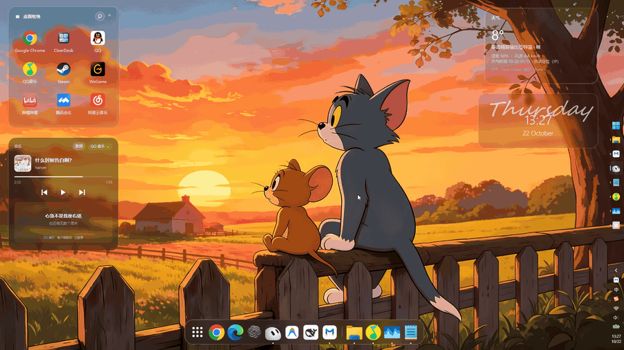
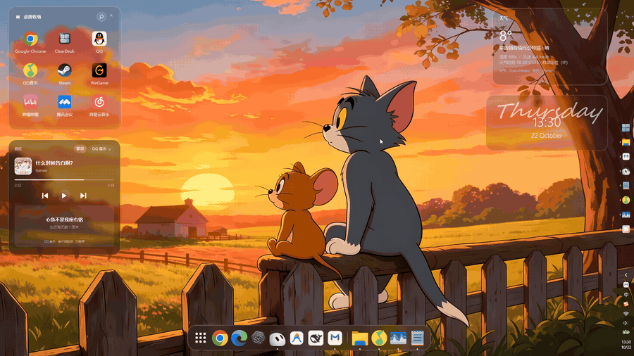
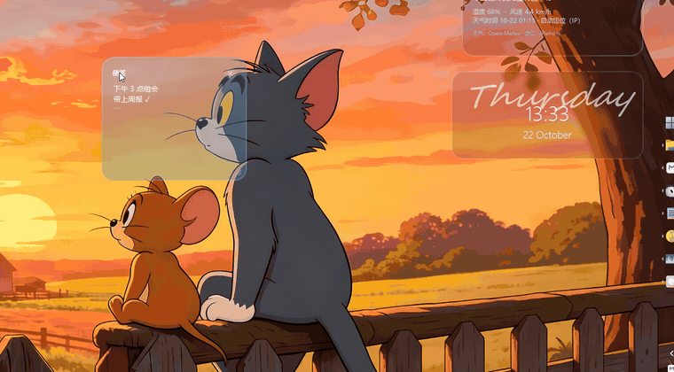
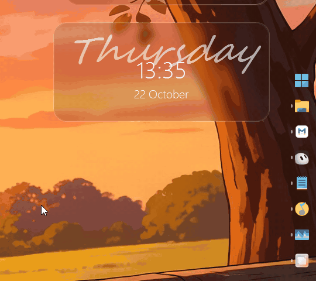
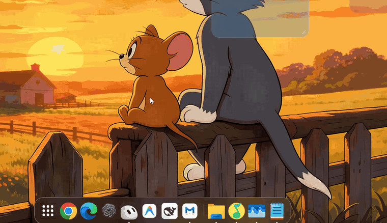
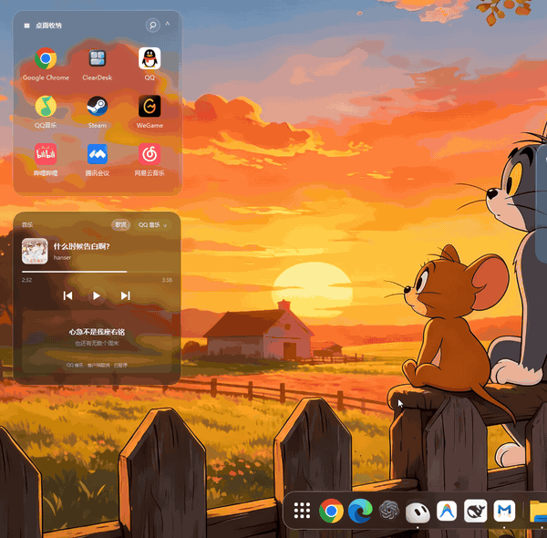
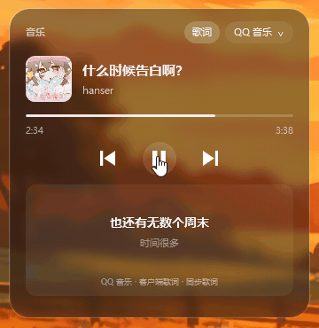
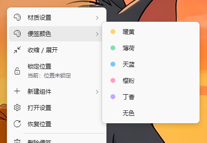
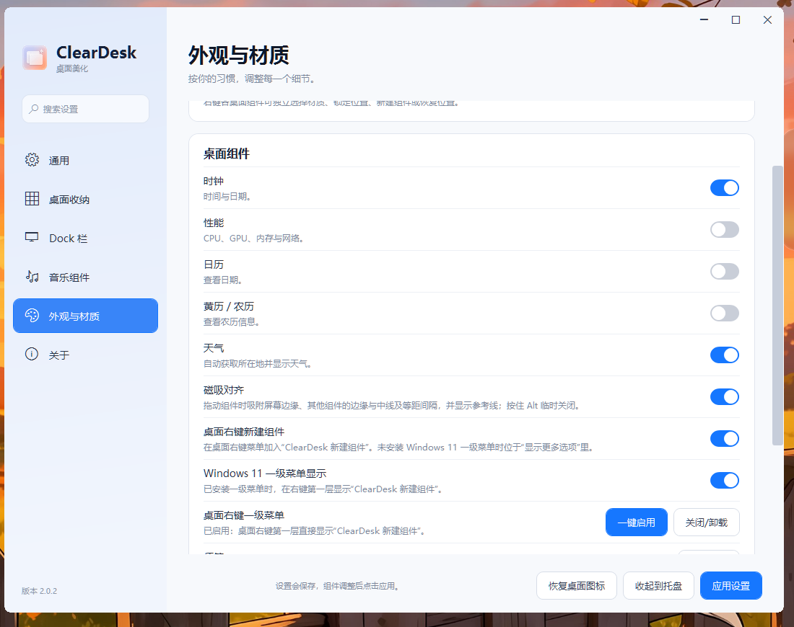

<p align="center"></p>

# ClearDesk

轻量 Windows 桌面整理工具，使用 C#、WPF 和 .NET Framework 4.8 构建。当前源码版本 **2.0.8**，维护者 [visual-life](https://github.com/visual-life)。



## 2.0 新功能

| | |
| --- | --- |
| **桌面右键新建组件**：Windows 11 第一层直接出现“ClearDesk 新建组件”，在设置里一键启用。<br> | **便签**：自动保存、多张、换颜色、调整大小。<br> |
| **磁吸对齐**：吸附边缘、中线和等距间隔，显示参考线；按住 Alt 自由放置。<br> | **锁定状态可见**：菜单显示当前状态，切换时有提示，悬停显示小锁。<br> |
| **启动台材质**：磨砂 · 实时模糊／玻璃 · 实时清透，右键即可切换，打开无闪烁。<br> | **Dock 发送至桌面收纳**：Dock 图标右键选择收纳格。<br> |
| **歌词与进度跳转**（1.9.1 起）：QQ 音乐／网易云歌词，点击或拖动细线进度条跳转。<br> | **Windows 11 风格菜单与设置**<br> |



动图均为 2.0.2 在 Windows 11 上的实际录屏；壁纸与第三方应用图标不属于 ClearDesk 自有素材。

## 版本历史

| 版本 | 日期 | 主要变化 |
| --- | --- | --- |
| **2.0.8** | 2026-10-23 | 修复网易云音乐最小化／关到托盘后音乐组件停住（快捷控制与音乐组件的音频 COM 声明冲突导致读不到音量，进度时钟不走）；拉大音乐组件时歌词字体自适应放大；锁定的组件固定在桌面最底层，点击不再浮到其他窗口上方。 |
| **2.0.7** | 2026-10-23 | 组件可分别调整宽和高（拖动右边缘／下边缘／右下角），内容重新排版：音乐显示更多歌词、天气加高显示多日预报；右键“恢复默认大小”；旧版缩放比例自动换算。 |
| **2.0.6** | 2026-10-23 | Dock 可调距屏幕底部距离；WLAN 直接弹出 Windows 11 网络列表；调整组件大小时显示参考线并贴齐；便签可插入图片；可选动态壁纸实时模糊；顶部任务栏只在有图标的位置唤出，减少误触。 |
| **2.0.5** | 2026-10-22 | 新增“顶部任务栏自动隐藏”（任务栏在顶部时由 ClearDesk 收起，鼠标碰上边缘平滑展开）；所有组件可调整大小，组件管理可“重置大小”。 |
| **2.0.4** | 2026-10-22 | 新增“快捷控制”组件：音量滑块与静音（跟随系统实时更新，可切换输出设备）、WLAN 与蓝牙开关及状态、Windows 设置快捷入口。 |
| **2.0.3** | 2026-10-22 | 设置新增“组件管理”：一处查看所有组件、便签和收纳格，显示／关闭、定位、删除、重命名收纳格；Dock 点击最前面的应用会最小化（与任务栏一致）；Dock 可选“窗口遮挡时自动隐藏”。 |
| **2.0.2** | 2026-10-22 | 设置里“一键启用”桌面右键一级菜单：本机生成专用证书（私钥不可导出），运行时签名，一次 UAC，发布包不含证书；移动文件夹后自动重新注册；启动台右键菜单只保留材质设置／添加到启动台／打开设置；修复启动台“磨砂”打开时先透明再闪一下。 |
| **2.0.1** | 2026-10-22 | Windows 11 桌面右键第一层直接显示“ClearDesk 新建组件”（稀疏包 + IExplorerCommand）；启动台可选“玻璃 · 实时清透／磨砂 · 实时模糊”；所有右键菜单统一为 Windows 11 白色样式（圆角、阴影、线性图标）；Dock 图标右键新增“发送至桌面收纳”。 |
| **2.0.0** | 2026-10-22 | 锁定状态清晰可见（菜单状态项、切换提示、悬停小锁）；桌面右键／组件菜单／托盘均可“新建组件”；新增便签组件（自动保存、多张、6 种颜色、可调大小）；拖动磁吸对齐（边缘、中线、等距，带参考线，Alt 临时关闭）；再次启动通过命名管道转发给已运行实例。 |
| **1.9.2** | 2026-10-22 | 内存大幅降低（本机私有内存 314 MB → 138 MB）：默认软件渲染（可开 GPU 加速）、壁纸按屏幕尺寸解码、GPU 采样改为 PDH、空闲回收；更换全新图标（不再是音乐主题）。 |
| **1.9.1** | 2026-10-21 | 修复网易云 3.1.1 读不到歌曲／歌词、最小化后进度与歌词停住；新增 QQ 音乐／网易云在线歌词与模糊匹配；细线进度条支持点击／拖动跳转。 |
| 1.8.2 及更早 | 2026-10 | 客户端歌词缓存、自动天气、Dock 关闭应用、收纳新建文件、启动台发送至收纳等，见 [CHANGELOG](CHANGELOG.md)。 |

每个版本的完整说明见 `docs/releases/<版本>.md`。

## 下载

推荐使用 **2.0.8**：完整解压后运行 `ClearDesk.exe`。升级前退出旧版本，保留包内的 `taskbar` 文件夹和 `ClearDeskShell.*`、`ClearDeskSign.exe`、`enable-menu.ps1`、`disable-menu.ps1`；已有设置会继续使用。需要 Windows 和 .NET Framework 4.8；一级右键菜单需要 Windows 11。

发行包见 [Releases](https://github.com/visual-life/ClearDesk/releases)。历史版本：[1.9.1](https://github.com/visual-life/ClearDesk/releases/tag/v1.9.1) · [1.8.2](https://github.com/visual-life/ClearDesk/releases/tag/v1.8.2)。

## 功能

- 桌面收纳：文件引用、搜索、网格／列表、拖动排序、调整大小和平滑滚动，不移动原文件。
- 收纳等桌面组件支持两种材质：实时透明玻璃，以及与桌面位置对齐的静态壁纸磨砂；文字和图标保持清晰。
- 便签：多行编辑、自动保存、可建多张，6 种颜色，右下角调整大小，悬停 × 删除。
- 新建组件：桌面右键（Windows 11 可放在第一层）、组件右键和托盘菜单都能新建便签、收纳格、时钟等组件。
- 磁吸对齐：拖动时吸附屏幕边缘、其他组件的边缘／中线和等距间隔，并显示参考线；按住 Alt 自由放置。
- 锁定状态可见：右键菜单显示“位置已锁定／未锁定”，切换时有提示，悬停显示小锁。
- Dock 右键“材质设置”可选实时清透玻璃或实时背景磨砂；模糊层使用 GPU 圆角裁切，后方窗口内容变化会同步呈现，不使用固定壁纸。启动台可选玻璃 · 实时清透或磨砂 · 实时模糊。
- 所有右键菜单统一为 Windows 11 白色样式：圆角、阴影、线性图标、勾选与子菜单箭头。
- 动态 Dock：固定项目、临时运行应用、分割线、运行小点；点击切换或还原已有窗口，右键固定／取消固定、发送至桌面收纳或正常关闭应用。
- Dock 平滑过渡：关闭应用时图标缩小淡出，旁边图标和背景同步收拢。
- 启动台：玻璃或实时磨砂材质，支持搜索和添加项目，点击外部或按 Esc 收起。
- Dock 自动显隐：同屏前台窗口最大化／全屏时隐藏，最小化后自动检查并恢复。
- 时钟、性能、日历／农历、天气和音乐组件；天气联网需要在设置中主动开启，自动定位近似城市，无手选城市。
- 音乐连接：自动或指定 QQ 音乐、网易云音乐、酷狗音乐；上一首、播放／暂停、下一首定向控制，保留本地音乐播放。
- 锁定即置底（2.0.8）：锁定的组件始终在桌面最底层，点击不会浮到其他软件或组件上方；网易云最小化／关到托盘时音乐进度和歌词继续走；拉大音乐组件歌词字体自动放大。
- 组件自由调整宽高（2.0.7）：时钟、性能、日历、黄历、天气、音乐、快捷控制拖动右边缘／下边缘／右下角分别调宽、调高，内容自动重新排版；右键“恢复默认大小”。
- 调整大小参考线（2.0.6）：调整组件和便签大小时贴齐其他组件、屏幕边缘或等宽等高；便签可粘贴／拖入／插入图片；Dock 距底部距离可调；可选动态壁纸实时模糊。
- 顶部任务栏自动隐藏（2.0.5）：任务栏放在屏幕顶部时由 ClearDesk 收起并把空间还给应用，鼠标停在上边缘平滑展开，只在有图标的位置唤出（2.0.6）。
- 快捷控制（2.0.4）：音量滑块与静音（跟随系统实时更新，点设备名切换输出设备）、WLAN 与蓝牙开关及连接状态、设置／显示／声音／可用网络快捷入口。
- 组件管理（2.0.3）：设置里一处查看全部组件、便签和收纳格，显示／关闭、定位、删除，直接重命名收纳格；“关闭”可恢复，“删除”不会动你的真实文件。
- Dock 点击与任务栏一致（2.0.3）：应用已在最前面时再点会最小化；可选“窗口遮挡时自动隐藏”，鼠标移到屏幕底部边缘唤出。
- 可选任务栏透明功能，通过独立的官方 TranslucentTB 组件实现。

## 本地构建

需要 Windows x64、Windows PowerShell 5.1 或 PowerShell 7，以及 .NET Framework 4.8、Windows 10/11 SDK（17763 或更新版本）。

```powershell
git clone https://github.com/visual-life/ClearDesk.git
cd ClearDesk
.\build.ps1
.\dist\ClearDesk.exe
```

首次构建会下载固定版本的 Roslyn 编译器并校验 SHA-256。也可以使用已有编译器：

```powershell
.\build.ps1 -Compiler 'D:\tools\roslyn\tasks\net472\csc.exe'
```

Windows 11 一级右键菜单组件（`shell/`）需要 Visual Studio C++ 工具和 Windows SDK：`.\shell\build-shell.ps1`，生成未签名的 ClearDeskShell.msix、ClearDeskShell.dll 和 ClearDeskSign.exe；最终用户在设置里“一键启用”时于本机签名。

任务栏透明为可选组件，源码仓库不存储其 EXE/DLL。需要此功能时运行：

```powershell
.\scripts\prepare-taskbar.ps1
```

脚本下载固定版本的官方便携包及对应源码，检查摘要，将组件放入 `dist/taskbar`，并保留许可证。已有完整发行包时可使用 `-SourceDirectory 'D:\ClearDesk\taskbar'` 离线准备。

## 使用与配置

设置保存在 `%LOCALAPPDATA%\ClearDesk\settings.json`；组件右键可切换材质、锁定位置或关闭。退出使用设置页“退出并恢复”或通知区域退出菜单。不要同时运行多个版本。

`ClearDesk.exe --preview` 使用程序目录中的独立测试配置。默认不会启用开机启动或天气联网。

## 开发与测试

```powershell
.\scripts\test.ps1 -Suite Self
.\scripts\test.ps1 -Suite Regression
.\scripts\test.ps1 -Suite PopupBenchmark
```

完整回归需要交互式 Windows 桌面，会短暂打开、最大化和最小化测试窗口；配置和结果写入 `artifacts`，不覆盖正式配置。测试运行器会等待进程退出并返回失败状态。CI 验证编译和基础自检；完整桌面交互需在本机验证。

目录说明及更多验证细节见 [开发说明](docs/DEVELOPMENT.md)，更新内容见 [CHANGELOG](CHANGELOG.md)。

## 已知范围

- 收纳框雾面使用静态壁纸，不会实时模糊其他应用，也不支持动态视频壁纸；启动台可选实时模糊。
- Dock 磨砂使用 Windows 合成背景，外观受系统透明效果和节能策略影响；当前已在本机 Windows 11 验证，Windows 10 兼容路径尚未实测。详见 [Dock 材质说明](docs/DOCK-MATERIALS.md)。
- Dock 以可见顶层窗口识别运行状态，包括最小化窗口；仅留在后台或托盘的程序不显示运行小点。
- 若最小化后另一个最大化窗口成为前台，Dock 会继续隐藏。
- 特殊启动器、浏览器应用、权限不同的窗口以及多显示器缩放组合可能需要适配。
- 性能基准中的 WPF 渲染回调间隔并非显示器 FPS；1.5.1 优化了首次布局和打开耗时，不代表所有机器上帧率都会提高。

## 许可

ClearDesk 自有代码使用 [MIT License](LICENSE)，版权所有者为 **visual-life**。第三方代码和可选组件的权利归其原作者，详见 [第三方许可](THIRD_PARTY_NOTICES.md)。
