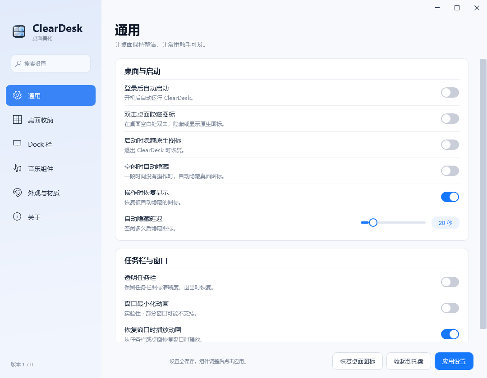
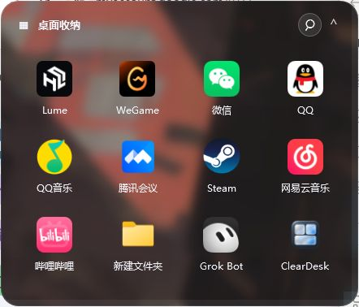
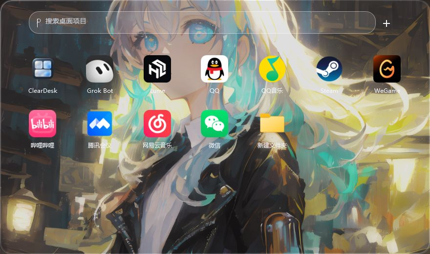

<p align="center"></p>

# ClearDesk

轻量 Windows 桌面整理工具，使用 C#、WPF 和 .NET Framework 4.8 构建。当前源码版本 **1.8.2**（本地待发布），维护者 [visual-life](https://github.com/visual-life)。

## 1.8.2 新功能

歌词优先读取 QQ 音乐和网易云客户端缓存，找不到时再联网匹配；客户端稍后加载的歌词会自动补读。详见 [1.8.2 更新说明](docs/releases/1.8.2.md)。

## 1.8.1 新功能

Dock 关闭操作置底；音乐组件增加可选同步歌词与本地 LRC 导入。详见 [1.8.1 更新说明](docs/releases/1.8.1.md)。

## 1.8.0 新功能

自动定位天气（已去掉手选城市）、Dock 右键关闭应用、收纳右键新建文件、启动台发送至收纳、更大的组件拖动区域与刷新开销优化。详细用法及验证范围见 [1.8.0 更新说明](docs/releases/1.8.0.md)。

## 下载

当前公开发行版仍为 1.7.0；1.8.2 源码和本地测试包已准备，尚未发布 GitHub Release。

[下载 ClearDesk 1.7.0（Windows x64，含完整源码）](https://github.com/visual-life/ClearDesk/releases/download/v1.7.0/ClearDesk-1.7.0-windows-x64-with-source.zip) · [版本说明与校验文件](https://github.com/visual-life/ClearDesk/releases/tag/v1.7.0)

完整解压后运行 `ClearDesk.exe`。升级前退出旧版本，保留包内的 `taskbar` 文件夹；已有设置会继续使用。需要 Windows 和 .NET Framework 4.8。

## 从 1.6.0 升级：这两版改了什么

| 版本 | 更新重点 |
| --- | --- |
| [1.6.2](docs/releases/1.6.2.md) | Dock 可选玻璃／实时磨砂，后方内容实时变化；修复黑底、矩形边角和白底白字二级菜单 |
| [1.7.0](docs/releases/1.7.0.md) | 全新浅色分类设置、搜索、统一控件与固定操作栏；设置中选择音乐来源和 Dock 材质 |

**直接下载 1.7.0 即可获得以上全部更新。** 1.6.1 为本地过渡版本，相关修复已纳入 1.6.2。

## 1.7.0 设置界面

- 浅色分组卡片、柔和蓝色侧栏、统一开关、滑块与下拉菜单。
- 六个设置分类与跨分类搜索，固定底部操作栏；原有配置继续使用。
- 音乐来源与 Dock 玻璃／实时磨砂可在设置中选择。
- 本次不改变桌面组件的材质实现、Dock 动画或音乐连接逻辑。



使用与变更见 [设置界面说明](docs/SETTINGS.md)。

## 1.6.0 更新重点

- 音乐卡片连接桌面音乐客户端，显示歌曲信息，并提供上一首、播放／暂停、下一首。支持自动或指定播放器，控制只发给当前选择的客户端。
- 将默认白色播放器下拉框换为深色圆角菜单，调整封面、文字、进度条和控制按钮；保留本地音乐播放。
- QQ 音乐已实测封面、进度和切歌。网易云音乐 3.1.1 新增无障碍控件兼容模式，已实测最小化后切歌；该模式没有封面，后台进度可能暂时停住。
- 酷狗音乐已实现系统媒体会话支持，但本机未安装，尚未实测。外部音乐连接需要 Windows 10 1809 或更新版本。
- 本地完整回归 **94 项通过**，覆盖音乐控制和原有桌面功能。

完整变更、实测版本和升级方法见 [1.6.0 发行说明](docs/releases/1.6.0.md)。

## 实际效果

以下为 **1.5.2 在 Windows 上实际运行的截图**，使用独立演示配置。Dock 和启动台后方为展示壁纸的演示窗口；壁纸及第三方应用图标不属于 ClearDesk 自有素材。

### 磨砂桌面收纳

背景柔和模糊，图标与文字保持清晰，支持搜索与拖动整理。



### 动态 Dock

分割线区分固定项目与临时运行应用，下方小点表示正在运行。关闭临时应用时，图标淡出缩小，其余图标与背景平滑收拢。


### 实时透明启动台

透明面板透出后方窗口，可搜索桌面项目；点击外部或按 Esc 收起。



### 音乐卡片（1.6.0）

深色圆角播放器菜单、清晰的歌曲信息和图形控制按钮。QQ 音乐已实测封面、进度和切歌；网易云 3.1.1 已实测兼容模式和后台切歌。酷狗接入系统媒体会话，尚未实测。详细限制见 [音乐连接说明](docs/MUSIC.md)。


网易云音乐兼容模式实际截图（音符为无封面时的占位图）：


## 功能

- 桌面收纳：文件引用、搜索、网格／列表、拖动排序、调整大小和平滑滚动，不移动原文件。
- 收纳等桌面组件支持两种材质：实时透明玻璃，以及与桌面位置对齐的静态壁纸磨砂；文字和图标保持清晰。
- Dock 右键“材质设置”可选实时清透玻璃或实时背景磨砂；模糊层使用 GPU 圆角裁切，后方窗口内容变化会同步呈现，不使用固定壁纸。启动台保持实时透明。
- 右键菜单与二级菜单采用统一深色圆角样式，清晰显示悬停状态、子菜单箭头和材质勾选。
- 动态 Dock：固定项目、临时运行应用、分割线、运行小点；点击切换或还原已有窗口，右键固定／取消固定或正常关闭应用。
- Dock 平滑过渡：关闭应用时图标缩小淡出，旁边图标和背景同步收拢。
- 启动台：实时透出后方窗口，支持搜索和添加项目，点击外部或按 Esc 收起。
- Dock 自动显隐：同屏前台窗口最大化／全屏时隐藏，最小化后自动检查并恢复。
- 时钟、性能、日历／农历、天气和音乐组件；天气联网需要在设置中主动开启，自动定位近似城市，无手选城市。
- 音乐连接：自动或指定 QQ 音乐、网易云音乐、酷狗音乐；上一首、播放／暂停、下一首定向控制，保留本地音乐播放。
- 可选任务栏透明功能，通过独立的官方 TranslucentTB 组件实现。

## 本地构建

需要 Windows x64、Windows PowerShell 5.1 或 PowerShell 7，以及 .NET Framework 4.8、Windows 10/11 SDK（17763 或更新版本）。

```powershell
git clone https://github.com/visual-life/ClearDesk.git
cd ClearDesk
.\build.ps1
.\dist\ClearDesk.exe
```

首次构建会下载固定版本的 Roslyn 编译器并校验 SHA-256。也可以使用已有编译器：

```powershell
.\build.ps1 -Compiler 'D:\tools\roslyn\tasks\net472\csc.exe'
```

任务栏透明为可选组件，源码仓库不存储其 EXE/DLL。需要此功能时运行：

```powershell
.\scripts\prepare-taskbar.ps1
```

脚本下载固定版本的官方便携包及对应源码，检查摘要，将组件放入 `dist/taskbar`，并保留许可证。已有完整发行包时可使用 `-SourceDirectory 'D:\ClearDesk\taskbar'` 离线准备。

## 使用与配置

设置保存在 `%LOCALAPPDATA%\ClearDesk\settings.json`；组件右键可切换材质、锁定位置或关闭。退出使用设置页“退出并恢复”或通知区域退出菜单。不要同时运行多个版本。

`ClearDesk.exe --preview` 使用程序目录中的独立测试配置。默认不会启用开机启动或天气联网。

## 开发与测试

```powershell
.\scripts\test.ps1 -Suite Self
.\scripts\test.ps1 -Suite Regression
.\scripts\test.ps1 -Suite PopupBenchmark
```

完整回归需要交互式 Windows 桌面，会短暂打开、最大化和最小化测试窗口；配置和结果写入 `artifacts`，不覆盖正式配置。测试运行器会等待进程退出并返回失败状态。CI 验证编译和基础自检；完整桌面交互需在本机验证。

目录说明及更多验证细节见 [开发说明](docs/DEVELOPMENT.md)，更新内容见 [CHANGELOG](CHANGELOG.md)。

## 已知范围

- 收纳框雾面使用静态壁纸，不会实时模糊其他应用，也不支持动态视频壁纸；启动台使用实时透明。
- Dock 磨砂使用 Windows 合成背景，外观受系统透明效果和节能策略影响；当前已在本机 Windows 11 验证，Windows 10 兼容路径尚未实测。详见 [Dock 材质说明](docs/DOCK-MATERIALS.md)。
- Dock 以可见顶层窗口识别运行状态，包括最小化窗口；仅留在后台或托盘的程序不显示运行小点。
- 若最小化后另一个最大化窗口成为前台，Dock 会继续隐藏。
- 特殊启动器、浏览器应用、权限不同的窗口以及多显示器缩放组合可能需要适配。
- 性能基准中的 WPF 渲染回调间隔并非显示器 FPS；1.5.1 优化了首次布局和打开耗时，不代表所有机器上帧率都会提高。

## 许可

ClearDesk 自有代码使用 [MIT License](LICENSE)，版权所有者为 **visual-life**。第三方代码和可选组件的权利归其原作者，详见 [第三方许可](THIRD_PARTY_NOTICES.md)。
