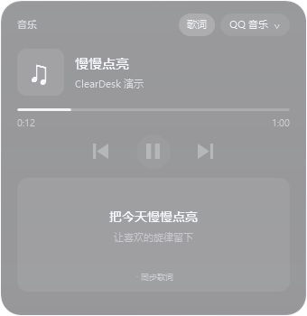

# ClearDesk 1.8.1 — 歌词与 Dock 菜单调整

维护者：visual-life。本地交付，尚未发布到 GitHub。

## 改了什么

- Dock 固定与临时应用的右键菜单均将“关闭应用”放在最底部，并用分隔线与移动操作分开。
- 音乐卡片右上角新增“歌词”按钮，点击开启／关闭。歌词显示在播放控制下方，突出当前句、弱化下一句；设置页也提供同一开关。
- 默认关闭歌词。开启后向 LRCLIB 发送当前歌名、歌手、专辑和可用时长匹配；仅匹配成功且带时间轴时同步滚动，不保证所有歌曲都被收录。
- 右键“导入当前歌曲歌词…”支持 LRC／TXT；本地音乐自动读取同名 LRC。没有时间轴或播放进度时显示可滚动文本。
- 切换歌曲／播放器后立即清除旧歌词；关闭歌词或组件取消请求。最多缓存 64 个匹配，避免每 0.75 秒重复联网。

## 使用

退出旧版，完整解压本包，运行 ClearDesk.exe。开启音乐客户端并播放歌曲后，点击组件右上角“歌词”。没匹配到时可右键导入对应 LRC；右键“重新匹配歌词”可清除导入关联并重试。开关及手动导入的文件关联会保存在本机配置。

联网范围、导入格式和网易云进度限制见 [音乐说明](../MUSIC.md)。包含 1.8.0 的自动天气、收纳文件创建、启动台发送和性能优化。

## 验证范围

回归覆盖菜单置底、歌词开关、同步句定位、回退、暂停、切歌、切换播放器、取消、过期返回、文件编码、匹配校验及缓存。另用公开示例元数据通过实际服务请求验证，不读取用户播放记录，不记录或打包返回的第三方歌词正文。组件效果图使用自编示例文本。

本机验证：**169 项桌面回归、17 项基础自检通过**；最终构建通过公开示例歌曲的真实歌词服务请求。

